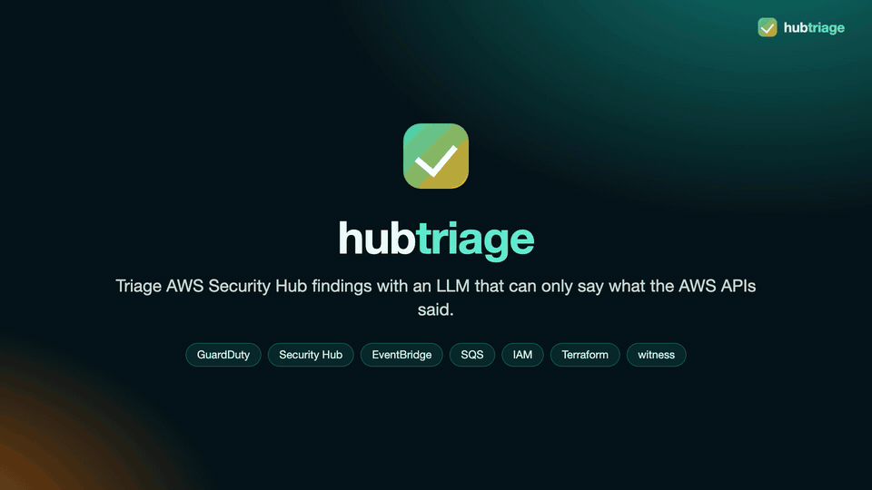

# hubtriage

**Triage AWS Security Hub findings with an LLM that can only say what the AWS APIs said.**

[](https://github.com/vinayvobbili/hubtriage/actions/workflows/ci.yml)



With sound (2 minutes, made from made-up cases):

https://github.com/user-attachments/assets/e98bdf7e-7714-476e-af27-0a288b598b43

A GuardDuty finding arrives in Security Hub. hubtriage asks AWS a fixed set of questions
about it — the instance, its security groups and its CloudTrail history, the IAM principal and
its policies, the CloudTrail events around it — and shows the answers to a model as records. The model
returns a verdict and the claims it rests on, each claim citing a record and a field.

Every claim then goes through [witness](https://github.com/vinayvobbili/witness)'s gate,
which re-reads the cited field from the recorded API response and compares it with what the
claim says. A claim that does not match is refused. The verdict that reaches Security Hub
is decided by what survived:

| Model says | Gate result | Written back |
|---|---|---|
| true positive | at least one claim admitted | `TRUE_POSITIVE`, admitted claims in the note |
| benign | every claim admitted, one of them citing what happened | `BENIGN_POSITIVE` |
| benign | any claim refused, or none cites what happened | `UNKNOWN`: needs a human |
| benign | from a model not trusted to dismiss (`HUBTRIAGE_MAY_DISMISS`) | `UNKNOWN`: needs a human |
| anything | no claim admitted, or unparseable | `UNKNOWN`: needs a human |
| not asked | the product marked it a sample | `FALSE_POSITIVE`, no lookups, no email |

The asymmetry is deliberate. A benign verdict closes the loop on an alert, so it has to rest
entirely on evidence; an escalation that also misread one detail is still an escalation.
"What happened" is CloudTrail's answer when CloudTrail was asked, even an empty one, and
otherwise the finding: the gate can check that a claim is true, not that the model left
nothing out, so a dismissal that cites only what was approved goes to a human.

The agent never closes a finding. It sets workflow to `NOTIFIED` and records its verdict in
the verification state and the note. The IAM policy on its role denies `RESOLVED` and
`SUPPRESSED`, and denies writing any field the product owns, so this rule lives in IAM and
not only in the code.

## Run it

```bash
git clone https://github.com/vinayvobbili/hubtriage && cd hubtriage
pip install -e .
hubtriage demo
```

No AWS account, no credentials, no model. The demo replays recorded API responses and
recorded answers through the real pipeline. Each case declares the verdict it should come
to, and the run exits non-zero if any case lands differently:

```
ok   root-login-misread  expected needs_human
  verdict   needs_human  (model said benign)
  why       benign, but 2 of 3 claim(s) were refused; a dismissal built on a misread record goes to a human
  ADMIT     Root called GetAccountSummary.
  REFUSE    The call came from the known admin address 203.0.113.10.
            f408c90c75fb#0000.CloudTrailEvent.sourceIPAddress: record says '198.51.100.7', claim asserts '203.0.113.10'
  REFUSE    The root session was MFA-authenticated.
            f408c90c75fb#0000.CloudTrailEvent.userIdentity.sessionContext.attributes.mfaAuthenticated: record says 'false', claim asserts 'true'
```

`hubtriage demo -v` also prints each `BatchUpdateFindings` request.

Against the live organization, `AWS_PROFILE=<security profile> hubtriage lab --instance i-...`
reports on the stage-21 lab: the instance's state, public IP and ingress open to the internet
(read through `--workload-profile`, default `hubtriage-workload`), then GuardDuty's real findings
for it, the detector's publishing frequency and member status, and usage by data source, which
shows whether flow logs are being analyzed at all. It only reads.

**The cases shipped today are synthetic.** Four were written by hand to drive the gate down
each path; fifteen more are generated by `scripts/synth_cases.py` to measure verdicts: approved
activity, the same activity past what was approved, and findings the records can't confirm; six
more in `fixtures/heldout` were written before any model answered them, to test a policy change.
Their "model answers" are reference answers, not a model's (see
[fixtures/synthetic/README.md](fixtures/synthetic/README.md)). They show that the pipeline
works; they say nothing about how accurate any model is. Cases recorded from a real
organization, and accuracy measured against live models, come next.

## Decisions and what failed

- **The model does not choose its lookups.** The questions asked about a finding are a fixed
  plan, because a model that picks its own lookups can also skip the one that would contradict it
  (`src/hubtriage/evidence.py`).
- **A benign verdict needs every claim admitted.** Closing an alert is the expensive direction to
  be wrong in, so one refused claim sends it to a human. A true positive only needs one admitted
  claim.
- **The model's summary is not written back.** The first time this ran, the summary of a refused
  benign verdict repeated both refused claims into the finding's note. The note now carries only
  admitted claims (`src/hubtriage/writeback.py`).
- **The no-close rule is in IAM, not only in code.** The agent's role denies `RESOLVED` and
  `SUPPRESSED` and denies writing fields the product owns, so a bug in the code cannot close a
  finding.
- **Key-shaped placeholders failed.** GitHub secret scanning flagged the AWS documentation
  placeholder in the fixtures as an access key id. They are now `ASIA-EXAMPLE-*`, and a test
  refuses any tracked file with that shape.
- **A network failure is not evidence.** A lookup AWS refused stays in the evidence as a gap the
  model is told about. A lookup that got no answer (no DNS, an expired login, throttling) stops the
  triage and leaves the message on the queue, so it cannot change a verdict or an accuracy number.
- **`terraform validate` passed; the first real apply did not.** Delegated-admin registrations
  conflict when they run in parallel. Delegating to an account whose hub is off switches it on with
  the default standards, so the hub now comes first, without them. Security Hub's `auto_enable`
  skips accounts that already exist, so those are enrolled as members. GuardDuty's `ALL` skips the
  management account, a day later it still wasn't watched, and it can only be added once GuardDuty is
  on there, so stage 10 turns it on and adds it. A delegated administrator
  cannot read back the organization trail it created, because the ARN names the management account,
  so the trail is managed from there.
- **The event can arrive before the finding can be read.** On the first live run a finding was
  still missing from `GetFindings` 54 seconds after its import event, and the re-read treated that
  as an error, which costs one of the message's three receives. It now waits and reads again. The
  same delay works the other way: a finding still read as `NEW` after its verdict was written, and
  a second delivery was triaged twice. The run now remembers what it has answered.
- **"Needs a human" was hiding a model outage.** With no model reachable, a live finding became
  `needs_human`, was marked `NOTIFIED` and left the queue, and the agent only picks up `NEW`, so it
  was never tried again. Now nothing is written or deleted and the run stops. The same outage
  scored as a correct verdict in the eval, which now reports no accuracy if any case got no answer.
- **The IAM limits are tested against AWS, not assumed.** `hubtriage check-iam` tries every write
  the agent must be refused, as the agent, and then a note it may write. It refuses to run on
  anything but a GuardDuty sample, since a rule that failed would change the finding. All ten
  attempts came out as expected.
- **The first live model answered "needs a human" every time.** Claude agreed with 1 of 4 labels: the
  prompt never defined the verdicts and told it to escalate whatever the records couldn't settle, and
  one label scored it against where the gate takes a deliberately wrong answer. With the verdicts
  defined, fifteen generated cases added and two ambiguous cases marked as contested, it agreed with
  all 19 labels and dismissed nothing it shouldn't have. Those are my labels on my cases, so this says
  the definitions are clear, not that the model is accurate. The eval now reports false benigns and a
  label-by-verdict table rather than one number. Its one refused claim was a correct reading with
  the wrong type (CloudTrail's `readOnly: true` cited as `"true"`), so the prompt now says a value
  keeps its JSON type.
- **The gate admitted two wrong dismissals.** Qwen 9B, the local model live findings go to, agreed
  with 14 of 19 labels, and two of its misses were benign verdicts whose every claim was true: an
  approved scanner's tag, never the outside address it scanned; a role's documented purpose, never
  the empty CloudTrail answer. A benign verdict now has to cite what happened. Requiring every kind
  of record was tried first and turned three of Claude's correct dismissals into escalations, over
  records (attached policies) that say neither what happened nor whether it was approved. The rule
  was shaped on those answers, so it was tested on six cases in `fixtures/heldout` written before
  any model saw them.
- **Sample findings went to the model.** The first findings pulled from the account were
  GuardDuty samples, and every one of them was set to go through the lookups and the local model.
  Their resources don't exist, so the honest answer was always needs_human, which emails a person
  about something that never happened. A sample is marked: ASFF's `Sample`, which only the
  importing product sets, and GuardDuty's own `additionalInfo/sample`, which one sample type
  (Discovery:IAMUser/AnomalousBehavior) leaves out. Either mark now decides the finding first and
  writes `FALSE_POSITIVE` without a lookup or a model. Only the marks count: the placeholder
  names in a sample's resources are something an attacker could pick too.
- **Not running on real findings yet.** The organization and security account are applied, but the
  agent has not triaged a real finding and the shipped cases are hand-written, so nothing here
  measures how accurate any model is.

## How it fits together

```
GuardDuty -> Security Hub (delegated admin, security account)
                 |  EventBridge: "Security Hub Findings - Imported"
                 v
               SQS (+ dead-letter queue)
                 |
              hubtriage-agent role  -- sts:AssumeRole -->  hubtriage-enrich (read-only, each account)
                 |                                              |
                 |   finding + ec2/iam/cloudtrail answers  <----+   recorded to a cassette
                 v
          witness store (records, hash-chained) -> prompt -> model -> claims -> gate
                 |
          BatchUpdateFindings: note, verification state, NOTIFIED
```

- `src/hubtriage/evidence.py`: the fixed questions each finding raises, and how the answers
  become records. CloudTrail's event bodies arrive as JSON strings, so they are decoded into
  a derived record whose tool call carries the raw response's hash.
- `src/hubtriage/verdict.py`: the schema, the gate call, and the verdict policy.
- `src/hubtriage/writeback.py`: the `BatchUpdateFindings` request. The note carries only
  admitted claims; the model's free-text summary is never written back.
- `src/hubtriage/llm.py`: local OpenAI-compatible hosts with failover between them, with
  Amazon Bedrock, the Claude API and the Antigravity CLI as other links in the same chain.
- `terraform/`: the organization, built in stages. See [terraform/README.md](terraform/README.md).

## Models

```bash
export HUBTRIAGE_LLM=local,bedrock                  # order of the failover chain
export HUBTRIAGE_LOCAL_URLS=http://host-a:8000/v1,http://host-b:8000/v1
export HUBTRIAGE_LOCAL_MODEL=<served model name>
export HUBTRIAGE_BEDROCK_MODEL=<model or inference profile id>
hubtriage eval --judge env
```

The made-up cases in `fixtures/` can also go to public APIs, which is the quickest way to an
accuracy number:

```bash
pip install -e '.[claude]'
HUBTRIAGE_LLM=claude,agy,local hubtriage eval --judge env
```

Live findings cannot. They carry real account ids, and a CloudTrail lookup can carry a person's
name and address, so `pull` and `consume` refuse `claude` and `agy` and run on local or Bedrock.

Neither of those may dismiss a finding yet. A benign verdict from a backend not named in
`HUBTRIAGE_MAY_DISMISS` (default `claude,agy`, which only ever see made-up cases) goes to a person,
like any other `needs_human`. Qwen 9B, the local model, dismissed a backup role rewriting its
bucket's policy in every run, citing the right records and drawing the wrong conclusion, which no
check on the evidence can catch. A backend is added once a model it serves passes a held-out set
written after the last change, with no false benign. A shared local server queues requests from
other programs, so `HUBTRIAGE_LOCAL_TIMEOUT` (seconds, default 120) counts the wait too.

## Graph engine

An alternative to the default pipeline: the same steps (`evidence.collect`, the prompt, the judge, the
gate, `build_update`, `BatchUpdateFindings`) as LangGraph
nodes, with the routing explicit, and a pause before any dismissal. The pipeline stays the default.

```bash
pip install -e '.[graph]'
hubtriage triage fixtures/synthetic/ci-user-deploys --engine graph
hubtriage pull --engine graph --write-back       # live; same model rules as the pipeline
hubtriage paused                                 # triages waiting for a person
hubtriage resume <thread> approve                # or reject
```

A benign verdict that survives the gate stops at `interrupt()` and is not written. Its state is kept in
SQLite (`runs/graph.db`, or `HUBTRIAGE_GRAPH_DB` / `--graph-db`), so `resume` can finish it from another
process. The model is the same judge chain as the pipeline (`HUBTRIAGE_LLM`, default local then Bedrock),
so live findings are refused by the public backends here too.

| Case | Route | Written back |
|---|---|---|
| the product marked it a sample | straight to write-back | `FALSE_POSITIVE` |
| HIGH or CRITICAL severity, whatever the model said | person | `UNKNOWN`: needs a human |
| the gate refused the verdict, or the model said needs a human | person | `UNKNOWN`: needs a human |
| benign from a backend outside `HUBTRIAGE_MAY_DISMISS` | person | `UNKNOWN`: needs a human |
| benign, every check passed | pause; approve | `BENIGN_POSITIVE` |
| benign, every check passed | pause; reject | `UNKNOWN`: needs a human |
| true positive | write-back | `TRUE_POSITIVE` |

## Status

- [x] Offline pipeline: evidence → records → verdict → gate → write-back request, with tests
- [x] Terraform stages 00 (organization), 10 (security account) and 20 (workload) applied to a real organization
- [ ] Record GuardDuty sample findings as cases
- [x] SQS consumer (`hubtriage consume`), run against the real queue on GuardDuty samples
- [x] Email alerts for findings that need a person and for parked messages
- [ ] Accuracy against live models on recorded cases
- [ ] OCSF reader for the newer Security Hub

## License

MIT
